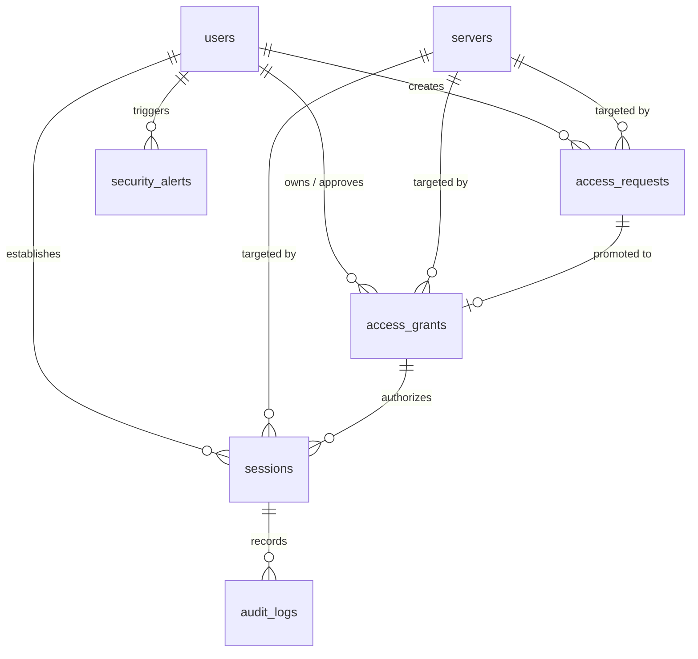

# Database Schema
## Secure Infrastructure Access Management and Session Monitoring System

This document outlines the schema design for both persistent storage (PostgreSQL) and temporary session cache (Redis).

---

## 1. Entity Relationship Diagram
The relationships between the PostgreSQL tables are structured as follows:



---

## 2. Table Definitions (PostgreSQL)

### 2.1. `users`
Stores system accounts and role configuration.
- **`id`**: `BIGSERIAL` (Primary Key)
- **`name`**: `VARCHAR(100)` (Not Null)
- **`email`**: `VARCHAR(255)` (Unique, Not Null)
- **`password_hash`**: `TEXT` (Not Null)
- **`role`**: `VARCHAR(20)` (Not Null) — Value constraints: `employee`, `manager`, `admin`
- **`created_at`**: `TIMESTAMP` (Not Null, Default: `NOW()`)
- **`updated_at`**: `TIMESTAMP` (Not Null, Default: `NOW()`)

### 2.2. `servers`
Stores target servers that users may request access to.
- **`id`**: `BIGSERIAL` (Primary Key)
- **`name`**: `VARCHAR(100)` (Not Null)
- **`host`**: `VARCHAR(255)` (Not Null)
- **`port`**: `INTEGER` (Not Null, Default: `22`)
- **`description`**: `TEXT` (Nullable)
- **`status`**: `VARCHAR(20)` (Not Null, Default: `'active'`)
- **`created_at`**: `TIMESTAMP` (Not Null, Default: `NOW()`)

### 2.3. `access_requests`
Represents an employee requesting temporary access to a server.
- **`id`**: `BIGSERIAL` (Primary Key)
- **`user_id`**: `BIGINT` (Foreign Key -> `users.id`, Not Null)
- **`server_id`**: `BIGINT` (Foreign Key -> `servers.id`, Not Null)
- **`reason`**: `TEXT` (Not Null)
- **`requested_duration`**: `INTEGER` (Not Null, representing minutes)
- **`status`**: `VARCHAR(20)` (Not Null) — Value constraints: `pending`, `approved`, `denied`, `cancelled`, `expired`
- **`created_at`**: `TIMESTAMP` (Not Null, Default: `NOW()`)
- **`updated_at`**: `TIMESTAMP` (Not Null, Default: `NOW()`)

### 2.4. `access_grants`
Represents approved temporary access records.
- **`id`**: `BIGSERIAL` (Primary Key)
- **`request_id`**: `BIGINT` (Foreign Key -> `access_requests.id`, Not Null)
- **`user_id`**: `BIGINT` (Foreign Key -> `users.id`, Not Null)
- **`server_id`**: `BIGINT` (Foreign Key -> `servers.id`, Not Null)
- **`approved_by`**: `BIGINT` (Foreign Key -> `users.id`, Not Null)
- **`access_type`**: `VARCHAR(20)` (Not Null, Default: `'ssh'`)
- **`started_at`**: `TIMESTAMP` (Not Null)
- **`expires_at`**: `TIMESTAMP` (Not Null)
- **`status`**: `VARCHAR(20)` (Not Null) — Value constraints: `active`, `expired`, `revoked`
- **`created_at`**: `TIMESTAMP` (Not Null, Default: `NOW()`)

### 2.5. `sessions`
Represents active or historical SSH connections routed through the gateway.
- **`id`**: `UUID` (Primary Key)
- **`grant_id`**: `BIGINT` (Foreign Key -> `access_grants.id`, Not Null)
- **`user_id`**: `BIGINT` (Foreign Key -> `users.id`, Not Null)
- **`server_id`**: `BIGINT` (Foreign Key -> `servers.id`, Not Null)
- **`started_at`**: `TIMESTAMP` (Not Null, Default: `NOW()`)
- **`ended_at`**: `TIMESTAMP` (Nullable)
- **`status`**: `VARCHAR(20)` (Not Null) — Value constraints: `active`, `completed`, `terminated`, `expired`, `blocked`
- **`termination_reason`**: `VARCHAR(100)` (Nullable) — Value constraints: `user_disconnect`, `access_expired`, `policy_violation`, `gateway_error`

### 2.6. `audit_logs`
Stores security-related events and actions executed during active sessions.
- **`id`**: `BIGSERIAL` (Primary Key)
- **`session_id`**: `UUID` (Foreign Key -> `sessions.id`, Nullable)
- **`user_id`**: `BIGINT` (Foreign Key -> `users.id`, Nullable)
- **`server_id`**: `BIGINT` (Foreign Key -> `servers.id`, Nullable)
- **`event_type`**: `VARCHAR(50)` (Not Null) — Examples: `LOGIN`, `LOGOUT`, `ACCESS_REQUESTED`, `ACCESS_APPROVED`, `ACCESS_DENIED`, `SESSION_STARTED`, `SESSION_ENDED`, `COMMAND_EXECUTED`, `COMMAND_BLOCKED`, `SECURITY_ALERT`
- **`event_data`**: `JSONB` (Nullable)
- **`timestamp`**: `TIMESTAMP` (Not Null, Default: `NOW()`)

### 2.7. `security_alerts`
Tracks security alerts generated from anomalous behaviors or blocked terminal entries.
- **`id`**: `BIGSERIAL` (Primary Key)
- **`session_id`**: `UUID` (Foreign Key -> `sessions.id`, Nullable)
- **`user_id`**: `BIGINT` (Foreign Key -> `users.id`, Nullable)
- **`server_id`**: `BIGINT` (Foreign Key -> `servers.id`, Nullable)
- **`rule`**: `VARCHAR(100)` (Not Null) — Example: `SENSITIVE_FILE_ACCESS`
- **`severity`**: `VARCHAR(20)` (Not Null) — Value constraints: `low`, `medium`, `high`, `critical`
- **`description`**: `TEXT` (Not Null)
- **`status`**: `VARCHAR(20)` (Not Null, Default: `'open'`) — Value constraints: `open`, `reviewed`, `resolved`
- **`created_at`**: `TIMESTAMP` (Not Null, Default: `NOW()`)

---

## 3. Temporary Cache State Schema (Redis)
Redis is used exclusively to facilitate high-speed, temporary authorization state querying by the SSH gateway.

### 3.1. Authorization Cache Key Schema
- **Key Pattern**: `access:{user_id}:{server_id}`
- **Example Key**: `access:17:2` (User ID 17, Server ID 2)
- **Time To Live (TTL)**: Configured dynamically to match the remaining access grant duration in seconds (e.g., `1800` for 30 minutes).

### 3.2. Cached Data Value Structure (JSON)
```json
{
  "userId": 17,
  "serverId": 2,
  "accessType": "ssh",
  "expiresAt": "2026-08-21T18:30:00+05:30"
}
```
*Note: When the Redis TTL reaches zero, the key is automatically evicting, disabling any future connection handshakes for that user-server mapping.*

---

## 4. Crucial Schema Rules
1. **Never Store Plaintext Credentials**: All user passwords must be hashed (using `bcrypt` or `argon2`) before saving. Target server private keys must be stored in encrypted columns or loaded via an external Secrets Manager.
2. **Immutable Audit Trails**: The `audit_logs` table must be write-only. Database triggers or application-level rules should forbid deletion or updates.
3. **Automated Expiry State Sync**: When a grant expires (checked via database trigger or background workers), the status of the `access_grants` table must transition to `expired`.
