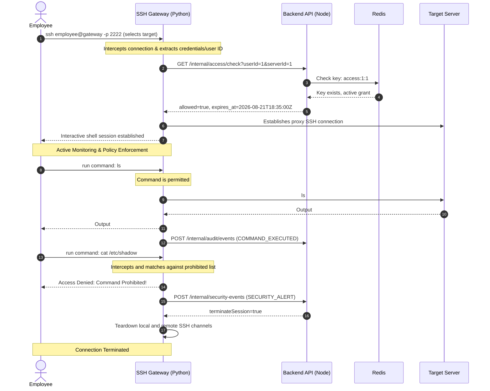

# Technical Requirement Document (TRD)
## Secure Infrastructure Access Management and Session Monitoring System

---

## 1. System Architecture & Components
The system is built as a multi-service distributed architecture coordinated using Docker Compose. The components interact as follows:

```
 ┌─────────────────────┐
 │    React + Vite     │
 │    Web Dashboard    │
 └──────────┬──────────┘
            │
       HTTP / JSON
            │
            ▼
 ┌─────────────────────┐
 │  Node.js + Express  │
 │     Backend API     │
 └───────┬───────┬─────┘
         │       │
    PostgreSQL  Redis
         │       │
    Internal API │
         │       │
         ▼       ▼
 ┌─────────────────────┐
 │  Python + AsyncSSH  │
 │    SSH Gateway      │
 └──────────┬──────────┘
            │
           SSH
            │
            ▼
 ┌─────────────────────┐
 │    Target Server    │
 │  Linux SSH Server   │
 └──────────┬──────────┘
            │
      Session Events
            │
            ▼
 ┌─────────────────────┐
 │ Monitoring & Audit  │
 │ (Prometheus/Grafana)│
 └─────────────────────┘
```

---

## 2. Technology Stack & Rationale

| Layer | Technology | Rationale |
| :--- | :--- | :--- |
| **Frontend** | React (Vite) + Tailwind CSS | Component-based modern UI, rapid hot-reloading development, and utility-first styling. |
| **Backend API** | Node.js + Express.js | Event-driven, asynchronous server model suitable for lightweight APIs and high concurrency. |
| **SSH Gateway** | Python + AsyncSSH | Python's `asyncssh` library provides a robust implementation of the SSHv2 protocol with native asynchronous capability for managing concurrent tunnels. |
| **Database** | PostgreSQL | Relational database ideal for transactional consistency of users, request states, grants, and audit trails. |
| **Temporary State** | Redis | High-speed in-memory store. Stores temporary access tokens and active grants, allowing the gateway to query authorizations with sub-millisecond latency. Mapped with TTL to enforce expiry. |
| **Monitoring** | Prometheus + Grafana | Time-series data collector and visualization platform for real-time tracking of active connections, blocked actions, and service health. |

---

## 3. Core Access & Session Flows

### 3.1. Just-In-Time Access Request Sequence
1. **Request**: The employee submits an access request specifying the target server, requested duration (minutes), and reason.
2. **Review**: The request status is set to `PENDING` and stored in PostgreSQL.
3. **Approval**: A manager reviews the request. Upon approval:
   - The status in PostgreSQL updates to `APPROVED`.
   - An `access_grant` is created with a calculated `expires_at` timestamp.
   - A fast-access key is written to Redis: `access:{user_id}:{server_id}` containing token and expiration, set with a Time-To-Live (TTL) matching the duration.
4. **Notification**: The employee dashboard updates, displaying the active grant and SSH connection details.

### 3.2. SSH Gateway Session & Interception Flow


---

## 4. Key Security & Compliance Principles

### 4.1. Just-In-Time (JIT) Privilege Elevation
Permissions are granted on-demand and valid only for a limited timeframe, reducing the credential exposure window to the absolute minimum.

### 4.2. Least Privilege
Access grants are strictly limited to the requested server and specific permissions. No wildcards or global credentials are provided to the end users.

### 4.3. Absolute Session Isolation
The SSH gateway acts as an application layer proxy. Requesters never receive the actual target server keys or passwords; the gateway holds the target secrets securely and performs authentication on the user's behalf.

### 4.4. Expiry Enforcement Gate
Even if the frontend or database records are out-of-sync, the gateway periodically checks the active session expiration timestamp. If the expiration limit is reached:
- The SSH Gateway immediately terminates the socket connection.
- An `ACCESS_EXPIRED` event is emitted.
- The Redis key expires automatically.

### 4.5. Continuous Session Auditability
Every keystroke, execution statement, and session lifecycle change must be logged. Logs are write-once and forwarded to a persistent, secure storage instance.
